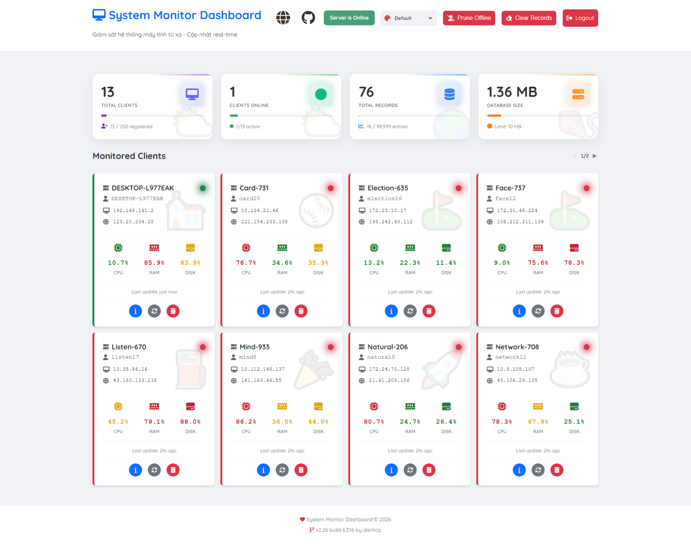
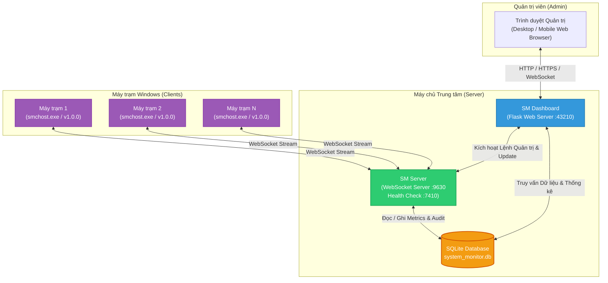

# 🛡️ System Monitor

<p align="center">
  <b><i>Giải pháp giám sát, kiểm toán và quản trị máy trạm Windows tập trung từ xa theo thời gian thực.</i></b>
</p>

<p align="center">
  
</p>

---

## 📖 Giới thiệu

**System Monitor** là giải pháp phần mềm cấp doanh nghiệp và cá nhân, cho phép quản trị viên giám sát hiệu năng, kiểm toán thông tin phần cứng/phần mềm, quản lý file, điều khiển dòng lệnh từ xa và tự động cập nhật phiên bản máy trạm trên diện rộng một cách mượt mà, bảo mật và hoàn toàn tự động.

---

## 📜 Mục lục

- [✨ Tính năng nổi bật](#-tính-năng-nổi-bật)
- [🏗️ Kiến trúc hệ thống](#️-kiến-trúc-hệ-thống)
- [🧩 Các thành phần chính](#-các-thành-phần-chính)
- [🖥️ Yêu cầu hệ thống](#️-yêu-cầu-hệ-thống)
- [🚀 Hướng dẫn Đóng gói & Triển khai](#-hướng-dẫn-đóng-gói--triển-khai)
  - [1. Đóng gói tự động bằng `build.bat`](#1-đóng-gói-tự-động-bằng-buildbat)
  - [2. Triển khai trên Máy chủ (Server)](#2-triển-khai-trên-máy-chủ-server)
  - [3. Triển khai trên Máy trạm (Client)](#3-triển-khai-trên-máy-trạm-client)
- [🔄 Cơ chế Tự động Cập nhật Client (Auto Update)](#-cơ-chế-tự-động-cập-nhật-client-auto-update)
- [📂 Tính năng Quản lý Tệp từ xa (File Manager)](#-tính-năng-quản-lý-tệp-từ-xa-file-manager)
- [⚙️ Cấu hình hệ thống (`config.ini`)](#️-cấu-hình-hệ-thống-configini)
- [🧹 Quản trị và Tối ưu Cơ sở dữ liệu](#-quản-trị-và-tối-ưu-cơ-sở-dữ-liệu)
- [✍️ Tác giả & Bản quyền](#️-tác-giả--bản-quyền)

---

## ✨ Tính năng nổi bật

### 1. 📊 Giám sát Hiệu năng Thời gian thực (Realtime Metrics)
- Theo dõi tức thời phần trăm tải CPU, mức dung lượng RAM, Disk Space, Disk I/O (Read/Write bytes/sec) và Network I/O (Download/Upload bits/sec).
- Hiển thị biểu đồ lịch sử chi tiết tương tác nhiều mốc thời gian, tự động làm mới mượt mà.
- Phân loại trực quan mức độ tải: Xanh (Thấp: <35%), Vàng (Trung bình: 35-70%), Đỏ (Cao: >70%).

### 2. 🔍 Kiểm toán Hệ thống Toàn diện (System Audit)
- **Phần cứng:** Chi tiết CPU (Model, Cores, Threads, Clock Speed), RAM (Dung lượng, Bus, Khe cắm), Mainboard, GPU (VRAM, Driver), Ổ cứng (Dung lượng, Serial), Card mạng, Máy in.
- **Hệ điều hành & Định danh:** Phiên bản OS, Build number, Install date, UUID/GUID bo mạch chủ, Machine ID.
- **Bảo mật & Hoạt động:** Windows Event Logs, Tài khoản người dùng (Users), Thông tin đăng nhập lưu trên máy (Credentials), Lịch sử duyệt web (Web History từ Chrome, Edge, Firefox, Brave...).
- **Tiến trình & Dịch vụ:** Danh sách phần mềm đã cài đặt, ứng dụng khởi động cùng Windows (Startup), các tiến trình đang chạy (Running Processes) và các dịch vụ Windows Services.

### 3. 🎮 Điều khiển & Quản trị từ xa (Remote Control)
- **Remote Terminal:** Hỗ trợ tương tác 2 chiều mượt mà với cả **Command Prompt (CMD)** và **PowerShell** trực tiếp trên giao diện Web Dashboard qua WebSocket.
- **File Manager chuyên nghiệp:**
  - Duyệt cây thư mục và danh sách ổ đĩa (C:, D:, E:...).
  - Điều hướng bằng thanh đường dẫn (Breadcrumbs) hoặc click đúp vào thư mục.
  - Tải lên tệp (Upload) trực tiếp vào thư mục hiện hành.
  - Tạo thư mục mới (New Folder), Xóa tệp hoặc thư mục (Delete).
  - Tải xuống tệp đơn lẻ hoặc **tự động nén cả thư mục thành tệp ZIP** ngay tại máy trạm rồi truyền về trình duyệt qua Base64 chunking.
- **Quản lý Tiến trình (Task Manager):** Xem danh sách PID, Memory, CPU và ra lệnh buộc dừng (Kill Process) ngay lập tức.
- **Quản lý Dịch vụ (Services):** Khởi động (Start), Dừng (Stop), Khởi động lại (Restart) các Windows Services.
- **Chụp màn hình (Remote Screenshot):** Chụp và xem ảnh màn hình máy trạm theo thời gian thực.

### 4. 🔄 Cập nhật Máy trạm Tự động & Ẩn hoàn toàn (Silent Auto Update)
- Quản trị viên chỉ cần bấm nút **Cập nhật** (từng máy) hoặc **Cập nhật toàn bộ** ngay trên Dashboard.
- Server tự động đóng gói và đẩy bộ cài `client_setup.exe` (hoặc `data.zip`) trực tiếp qua WebSocket xuống máy trạm.
- Quá trình cập nhật tại máy trạm diễn ra **hoàn toàn ẩn ngầm trong nền 100% (Silent Update)** bằng trình thông dịch VBScript native (`wscript.exe`), không bật bất kỳ cửa sổ CMD hay thông báo nào.
- Tự động tắt `smchost.exe`, ghi đè phiên bản mới, cấu hình Registry Startup và khởi động lại Client.
- Nút Cập nhật trên Dashboard chỉ xuất hiện khi phát hiện máy trạm có phiên bản cũ, rê chuột (hover) vào nút sẽ hiển thị phiên bản hiện tại của máy đó.

### 5. 🔔 Cảnh báo Toàn cục & Nhật ký Hệ thống (Alerts & Logs)
- Thông báo Toast tức thì trên giao diện Web khi có máy trạm kết nối (Online), ngắt kết nối (Offline) hoặc khi CPU/RAM vượt ngưỡng cảnh báo.
- Trang Nhật ký hệ thống chuyên biệt (`/logs`) ghi lại toàn bộ lịch sử sự kiện với bộ lọc và tìm kiếm thời gian thực.

---

## 🏗️ Kiến trúc hệ thống



---

## 🧩 Các thành phần chính

| Thành phần | Tệp tin thực thi | Mô tả chức năng |
| :--- | :--- | :--- |
| **Server Lõi** | `SM Server.exe` | Lắng nghe kết nối WebSocket từ tất cả máy trạm (port `9630`), tiếp nhận metrics, giải mã audit, điều phối lệnh Remote Control và đẩy bản cập nhật. Tích hợp cổng Health Check `7410`. |
| **Web Dashboard** | `SM Dashboard.exe` | Máy chủ Web Flask (port `43210`), cung cấp giao diện quản trị đồ họa, đồ thị hiệu năng, file manager, terminal và REST API. |
| **Client Agent** | `smchost.exe` | Ứng dụng chạy ngầm trên máy trạm Windows, khởi động cùng hệ thống qua Registry, thu thập dữ liệu và thực thi lệnh từ Server. |
| **Bộ cài đặt Client** | `client_setup.exe` | Bộ cài đặt Silent tích hợp sẵn `smchost.exe` và `config.ini`, tự động bung vào `C:\Users\Public\SystemMonitor`, phân quyền và kích hoạt ngầm. |
| **Trình sửa Cấu hình** | `Config Editor.exe` | Công cụ giao diện đồ họa GUI hỗ trợ xem và chỉnh sửa an toàn tệp cấu hình mã hóa `config.ini`. |
| **Tạo Dữ liệu Mẫu** | `Audit Data Sample.exe` | Tiện ích sinh dữ liệu audit mẫu để kiểm thử và demo các tính năng phân tích. |

---

## 🖥️ Yêu cầu hệ thống

- **Hệ điều hành:** Windows 10, Windows 11, Windows Server 2016/2019/2022 (64-bit).
- **Môi trường phát triển / Build:** Python 3.10 trở lên, PyInstaller.
- **Mạng:** Kết nối mạng LAN hoặc Internet (WAN / VPN) giữa Client và Server.

---

## 🚀 Hướng dẫn Đóng gói & Triển khai

### 1. Đóng gói tự động bằng `build.bat`

Dự án đã tích hợp sẵn kịch bản đóng gói tự động toàn diện [build.bat](file:///E:/Project/System-Monitor/build.bat). Chỉ cần chạy tệp này với quyền Administrator:

```cmd
build.bat
```

**Kịch bản sẽ tự động:**
1. Dọn dẹp các thư mục rác (`dist/`, `build/`, `*.spec`).
2. Cài đặt các thư viện phụ thuộc từ `requirements/requirements.txt`.
3. Biên dịch các tệp `.exe` độc lập (`SM Server.exe`, `SM Dashboard.exe`, `smchost.exe`, `Config Editor.exe`, `Audit Data Sample.exe`).
4. Đóng gói bộ cài đặt độc lập `client_setup.exe` và tự động nén thành `data.zip` đặt vào thư mục cập nhật `static/updates/`.
5. Tạo cấu trúc thư mục phân phối chuẩn `source/` sẵn sàng đưa lên môi trường thực tế.

---

### 2. Triển khai trên Máy chủ (Server)

Thư mục phân phối trên máy chủ: `source/server/`

```
source/server/
├── SM Server.exe             # Khởi chạy WebSocket Server
├── SM Dashboard.exe          # Khởi chạy Web Dashboard
├── config.ini                # Tệp cấu hình máy chủ
├── system_monitor.db         # Cơ sở dữ liệu SQLite
├── templates/                # Giao diện HTML của Dashboard
└── static/
    ├── css/, js/, fonts/     # Tài nguyên giao diện tĩnh
    └── updates/              # Chứa client_setup.exe và data.zip để phục vụ tự động cập nhật
```

**Các bước vận hành:**
1. Khởi chạy `SM Server.exe`.
2. Khởi chạy `SM Dashboard.exe`.
3. Mở trình duyệt web và truy cập địa chỉ: `http://<IP_MAY_CHU>:43210`.
4. Đăng nhập với tài khoản mặc định (hoặc tài khoản đã cấu hình trong `config.ini`).

> [!TIP]
> Có thể sử dụng kịch bản [requirements/run_server.bat](file:///E:/Project/System-Monitor/requirements/run_server.bat) để khởi động cả Server và Dashboard cùng lúc chỉ với 1 click.

---

### 3. Triển khai trên Máy trạm (Client)

Thư mục máy trạm: `source/client/`

**Cách 1 (Khuyên dùng - Nhanh nhất):**
- Chỉ cần sao chép tệp `client_setup.exe` sang máy trạm và nhấp đúp chạy.
- Bộ cài sẽ tự động thực hiện:
  - Tắt phiên bản cũ (nếu có).
  - Cài đặt vào thư mục chuẩn: `C:\Users\Public\SystemMonitor\`.
  - Phân quyền tệp tin cho mọi Users.
  - Tạo mục khởi động tự động trong Windows Registry (`HKLM` hoặc `HKCU`).
  - Khởi động Client chạy ngầm với tham số `-minimized`.

**Cách 2 (Thủ công):**
- Sao chép thư mục chứa `smchost.exe` và `config.ini` vào máy trạm.
- Chạy `smchost.exe -minimized`.

---

## 🔄 Cơ chế Tự động Cập nhật Client (Auto Update)

Hệ thống sở hữu giải pháp cập nhật máy trạm từ xa tiên tiến:

```
[Dashboard] --(Bấm Cập nhật)--> [Server] --(WebSocket Push Base64)--> [Client Agent]
                                                                            |
                                                                   Ghi client_setup.exe
                                                                            |
                                                                Kích hoạt silent_updater.vbs
                                                                            |
                                                                   (Ẩn 100% không hiện CMD)
                                                                            |
                                                                 Tắt smchost -> Cài đè
                                                                            |
                                                                   Khởi động lại Client mới
```

- **Không phụ thuộc IP/Port HTTP:** Bản cập nhật được mã hóa Base64 và đẩy thẳng qua kết nối WebSocket hai chiều đang mở, đảm bảo cập nhật xuyên suốt ngay cả khi máy chủ đứng sau Cloudflare Tunnel, Domain hoặc Reverse Proxy.
- **Không hiện cửa sổ đen (Silent Update 100%):** Sử dụng trình điều khiển VBScript native (`wscript.exe`) với chế độ `SW_HIDE`, đảm bảo không một cửa sổ CMD hay thông báo nào bật lên màn hình người dùng máy trạm.
- **Tooltip thông minh:** Trên Dashboard, nút Cập nhật chỉ xuất hiện khi máy trạm có phiên bản cũ. Rê chuột vào nút sẽ hiển thị: `Phiên bản hiện tại: v{version} - Bấm để cập nhật`.

---

## 📂 Tính năng Quản lý Tệp từ xa (File Manager)

Tích hợp trực tiếp trong tab **File Manager** của từng máy trạm:

| Thao tác | Mô tả |
| :--- | :--- |
| **Duyệt thư mục** | Hỗ trợ duyệt nhanh toàn bộ ổ đĩa, phân trang và thanh Breadcrumbs điều hướng linh hoạt. |
| **Tải lên (Upload)** | Kéo thả hoặc chọn tệp từ máy quản trị để tải trực tiếp vào thư mục hiện hành trên máy trạm. |
| **Tải xuống (Download File)** | Tải tệp tin đơn lẻ từ máy trạm về máy quản trị với tốc độ cao. |
| **Tải xuống Thư mục (ZIP)** | Tự động nén thư mục thành file `.zip` tạm thời trên máy trạm, mã hóa truyền về trình duyệt và tự động dọn dẹp file tạm. |
| **Xóa & Tạo mới** | Tạo thư mục mới (New Folder) hoặc xóa vĩnh viễn tệp/thư mục (Delete) với hộp thoại xác nhận an toàn. |

---

## ⚙️ Cấu hình hệ thống (`config.ini`)

Toàn bộ cấu hình hệ thống được lưu trong tệp `config.ini` (được bảo vệ bằng mã hóa tự động). Có thể sử dụng **Config Editor.exe** để chỉnh sửa trực quan:

```ini
[server]
; Địa chỉ IP Server lắng nghe (0.0.0.0 để lắng nghe tất cả các card mạng)
host = 0.0.0.0
; Cổng WebSocket chính trao đổi dữ liệu với máy trạm
port = 9630
; Cổng Health Check máy chủ
health_check_port = 7410
; Mã khóa xác thực kết nối WebSocket giữa Client và Server
access_token = YOUR_SECRET_ACCESS_TOKEN
; Phiên bản mục tiêu của Client (dùng để phát hiện máy cần cập nhật)
client_version = 1.0.1

[webserver]
; Địa chỉ bind của Web Dashboard
server = 0.0.0.0
; Cổng truy cập Web Dashboard
port = 43210
; Tài khoản quản trị Web
username = admin
password = your_password
; Thời gian sống của phiên đăng nhập (phút)
session_lifetime = 60
; Tần suất làm mới dữ liệu tự động trên Dashboard (giây)
refresh_interval = 3
; Số lượng máy trạm hiển thị trên mỗi trang
limit_items_per_page = 20

[client]
; IP hoặc Tên miền của Máy chủ mà Client sẽ kết nối tới
server = 192.168.1.100
; Cổng kết nối (phải khớp với port của [server])
port = 9630
; Token xác thực (phải khớp với access_token của [server])
access_token = YOUR_SECRET_ACCESS_TOKEN
; Khoảng thời gian thử kết nối lại nếu mất mạng (giây)
retry_interval = 10
; Tần suất gửi thông số hiệu năng CPU/RAM/Disk/Network (giây)
refresh_interval = 3
; Tần suất gửi lại toàn bộ thông tin kiểm toán phần cứng/phần mềm (giây)
update_info_interval = 3600
```

---

## 🧹 Quản trị và Tối ưu Cơ sở dữ liệu

- **Downsampling tự động:** Định kỳ mỗi **1 giờ**, tác vụ nền tự động nén các bản ghi metrics chi tiết cũ hơn 24 giờ thành các giá trị trung bình theo giờ, giúp cơ sở dữ liệu luôn nhỏ gọn, giảm tới 95% dung lượng lưu trữ mà vẫn giữ được lịch sử dài hạn.
- **Xóa máy trạm Offline (Prune Offline Clients):** Hỗ trợ dọn dẹp các máy trạm không còn hoạt động chỉ với một nút bấm từ giao diện web.
- **Xóa bản ghi & Thu nhỏ DB (Clear Records & VACUUM):** Xóa toàn bộ lịch sử metrics và giải phóng không gian đĩa vật lý của tệp SQLite.

---

## ✍️ Tác giả & Bản quyền

- **Tác giả:** Cao Phước Danh
- **Hỗ trợ phát triển:** Google DeepMind / Antigravity AI
- **Giấy phép:** Dự án phục vụ mục đích học tập, quản trị hệ thống nội bộ và nghiên cứu phi thương mại.
